# Rig Jam layer audit (job U17)

Does anything hide or cut off what the player should be watching? The audit (`npm run test:e2e:layers`) plays every
sighting (each strip gag stepped through its run every quarter second; every sighting's preview in real time, for its
speech bubbles), a driver's bump line, trucks driving out by each side, the hint's rim, ghost and OUT badge, the win
card and its confetti, the finale's four parts, and the dig (its cards, every buried thing and find with its bubble,
the far side), at 390 x 844, 375 x 667 and 1440 x 900, in Chrome's engine and Safari's. At each sample it takes the
thing being watched and asks two questions: is something else painted over it (`elementsFromPoint` over its box,
counting only what really paints at that pixel), and does a parent cut it off (overflow, a picture's frame, a clip, a
mask, the screen's edge). A thing half off an edge on its way in or out is not a flag unless it stops there.

**13 distinct flags: 0 bugs open, 13 intended** (each answered for by a rule in `e2e/layer-audit/allow.mjs`, 20 rules, a line of why apiece). A new flag with no rule fails the test.

## Bugs the audit found, and what was done

None.

## Open bugs

None.

## Intended (on the allow list)

### a truck drives out (F): covered by the HUD

- **What:** the truck driving out, covered by the HUD (up to 14% of it, at 540 ms into its drive out).
- **Where:** Clearwater 3; seen at 375x667 in webkit.
- **Call:** intended. A truck that leaves by the top or the bottom passes UNDER the HUD, the tip line and the buttons (Jay, Oct 6), fading as it goes.

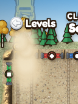

### a truck drives out (I): covered by the HUD

- **What:** the truck driving out, covered by the HUD (up to 27% of it, at 660 ms into its drive out).
- **Where:** Clearwater 3; seen at 375x667 in chromium and webkit.
- **Call:** intended. A truck that leaves by the top or the bottom passes UNDER the HUD, the tip line and the buttons (Jay, Oct 6), fading as it goes.

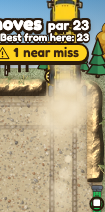

### sighting: aurora (its preview): clipped by the aurora sighting (its picture's frame)

- **What:** the coyote and the lights, clipped by the aurora sighting (its picture's frame) (up to 91% of it, at 0.4 s).
- **Where:** its preview level; seen at 1440x900 in chromium and webkit.
- **Call:** intended. The lights are drawn wider than the sky band they are shown in: its frame is the band's own edge.

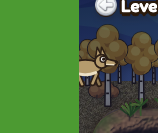

### sighting: aurora (its preview): covered by the HUD

- **What:** the coyote and the lights, covered by the HUD (up to 33% of it, at 2.8 s).
- **Where:** its preview level; seen at 1440x900 in chromium and webkit.
- **Call:** intended. The northern lights run up behind the HUD, and the coyote leaves BEHIND the front tree line.

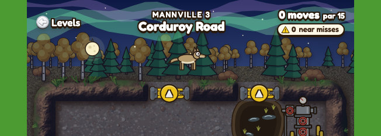

### sighting: beaver: covered by the lane aspen

- **What:** scene-layer#0, covered by the lane aspen (up to 92% of it, at 7.25 s).
- **Where:** Mannville 3; seen at 1440x900, 375x667, 390x844 in chromium and webkit.
- **Call:** intended. The joke itself: upright, his pipe and he squeeze past BEHIND the aspen.

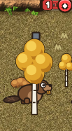

### sighting: bell: covered by the rig mats

- **What:** scene-layer#0; scene-layer#1; scene-layer#2, covered by the rig mats (up to 100% of it, at 4.50 s).
- **Where:** Clearwater 3; seen at 390x844 in chromium and webkit.
- **Call:** intended. Dinner Bell: two of the four in the stampede run BEHIND the rig mat stack and two in front, as the reference draws it.

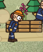

### sighting: geese: covered by the berm

- **What:** scene-layer#7, covered by the berm (up to 100% of it, at 7.25 s).
- **Where:** Cardium 3; seen at 1440x900 in chromium and webkit.
- **Call:** intended. The V flies BEHIND the HUD and the lease; on a short sky band it crosses behind the lease itself, and the feather drifts down behind it.

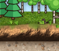

### sighting: geese (its preview): covered by the lease's ground

- **What:** a goose, covered by the lease's ground (up to 90% of it, at 5.9 s).
- **Where:** its preview level; seen at 1440x900 in chromium and webkit.
- **Call:** intended. The V flies BEHIND the HUD and the lease; on a short sky band it crosses behind the lease itself, and the feather drifts down behind it.

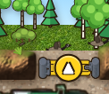

### sighting: geese (its preview): covered by the berm

- **What:** a goose, covered by the berm (up to 92% of it, at 6.9 s).
- **Where:** its preview level; seen at 1440x900 in chromium and webkit.
- **Call:** intended. The V flies BEHIND the HUD and the lease; on a short sky band it crosses behind the lease itself, and the feather drifts down behind it.

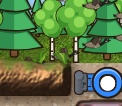

### sighting: moose (its preview): covered by the berm

- **What:** the moose, covered by the berm (up to 100% of it, at 0.4 s).
- **Where:** its preview level; seen at 1440x900, 390x844 in chromium and webkit.
- **Call:** intended. The moose rises from BEHIND the top berm: only his antlers and head show over it.

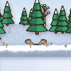

### sighting: muskeg: covered by the lane aspen

- **What:** scene-layer#4, covered by the lane aspen (up to 80% of it, at 6.75 s).
- **Where:** Mannville 3; seen at 1440x900, 375x667 in chromium and webkit.
- **Call:** intended. Mannville's lane aspen stands in front of the walking lane on every level (the depth rule): whoever walks the lane passes behind its trunk.

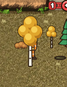

### the finale: photo: covered by a speech bubble

- **What:** the crew, covered by a speech bubble (up to 100% of it, at 0.75 s into photo).
- **Where:** the finale's stage; seen at 1440x900, 375x667, 390x844 in chromium and webkit.
- **Call:** intended. "Squeeze in!": the bubble's tip is on Moe at the camera, and its end lies over a corner of the camera for a second.

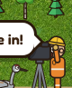

### the finale: photo: covered by the berm

- **What:** the crew, covered by the berm (up to 100% of it, at 7.50 s into photo).
- **Where:** the finale's stage; seen at 1440x900, 375x667 in chromium.
- **Call:** intended. The magpie flies off up and away past the top of the strip: on a short strip its last frames are behind the lease.

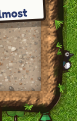

